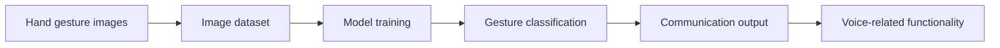

<div align="center">

# 🤟 Sign Language Recognition & Voice Communication

### Artificial Intelligence for Accessibility and Inclusion

**Exploring how computer vision and supervised learning can help bridge communication barriers.**


[](https://lnkd.in/p/dqEhWNtm)
[](https://lnkd.in/p/dqEhWNtm)

</div>

---

## 🎬 Project Demo

**[▶ Watch the sign language recognition demo on LinkedIn](https://lnkd.in/p/dqEhWNtm)**

The demonstration was shared on **Argentine Sign Language Day (29 August)** as part of a reflection on the importance of inclusive technologies and accessible communication.

> *Technology has the potential to make a meaningful difference in people's everyday lives. This project was one of my first steps into artificial intelligence—and an opportunity to explore that potential through accessibility.*

**[See the demo and original LinkedIn post →](https://lnkd.in/p/dqEhWNtm)**

> **Tip:** To display a video preview directly here on GitHub, add a screenshot named `assets/demo-preview.png` to the repository, then uncomment the following Markdown:
>
> `[](https://lnkd.in/p/dqEhWNtm)`

---

## 🌱 Why I Built This

This is one of the first projects I developed while exploring **Artificial Intelligence and Machine Learning**.

I wanted to work on something beyond a technical exercise: a project connected to a real human challenge. Communication accessibility matters in education, workplaces and everyday life. Exploring the recognition of hand gestures was an opportunity to learn about AI while considering how technology might contribute to a more inclusive society.

This project reflects an idea that continues to guide my work: **AI should not only advance technology—it should also create positive social impact.**

---

## 🧠 Project Overview

This repository explores **sign-language gesture recognition and voice-based communication** using Python and machine-learning techniques. Its notebooks organise the work into image collection, model training and voice-related functionality.

**Core areas explored:**

- Image-based gesture data collection
- Supervised learning for gesture classification
- Recognition of selected hand gestures
- Voice-related processing within an accessible communication prototype
- Experimental development and presentation in Jupyter notebooks

The project is an **educational proof of concept**, not a complete translator for Argentine Sign Language (*Lengua de Señas Argentina*, LSA).

### Conceptual workflow



*The diagram summarises the project concept; refer to the notebooks for implementation details.*

---

## 🛠️ Technologies

| Technology | Role |
|---|---|
| **Python** | Main development language |
| **Jupyter Notebook** | Experiments, model development and demonstrations |
| **TensorFlow** | Machine-learning experimentation |
| **PyTorch** | Machine-learning experimentation |
| **Computer Vision** | Image-based gesture recognition |
| **Supervised Learning** | Training a classifier using labelled examples |

*TensorFlow and PyTorch are referenced in the original project announcement. For exact dependencies and versions, consult the notebook imports and your local environment.*

---

## 📁 Repository Structure

```text
Reconocimiento_gestos_ad_voz/
├── Tensorflow/
├── 1. Collección de imagenes - Data set.ipynb
├── 2. Detección y entrenamiento.ipynb
├── 3. Deteccion de voz.ipynb
├── 5. Presentación.ipynb
├── Doc - Sistema de comunicación inclusiva .docx
├── model.json
└── README.md
```

| File | Purpose |
|---|---|
| `1. Collección de imagenes - Data set.ipynb` | Image collection and dataset preparation |
| `2. Detección y entrenamiento.ipynb` | Gesture detection and model training |
| `3. Deteccion de voz.ipynb` | Voice-related experimentation |
| `5. Presentación.ipynb` | Project presentation |
| `Doc - Sistema de comunicación inclusiva .docx` | Original documentation, including setup and system structure |
| `model.json` | Model-related configuration or structure |

---

## 🚀 Explore the Project

1. Clone the repository:

   ```bash
   git clone https://github.com/breenavalos/Reconocimiento_gestos_ad_voz.git
   cd Reconocimiento_gestos_ad_voz
   ```

2. Open the repository in **Jupyter Notebook** or **JupyterLab**.
3. Read `Doc - Sistema de comunicación inclusiva .docx` for the original setup and system details.
4. Explore the numbered notebooks, starting with image collection and then training.
5. Review package imports and configure dependencies, local paths and any camera/audio permissions required by the relevant notebook before executing cells.

**Note:** A reproducible installation command and pinned dependency versions have not yet been published in this README. The notebooks may require adjustments for modern environments.

---

## ♿ Accessibility, Scope & Responsible AI

Sign languages are **complete natural languages**, with grammar and meaning extending beyond isolated hand gestures. Facial expressions, body movement, signing space, context and regional variation all matter.

This prototype explores recognition of a limited set of gestures. It **does not claim to fully interpret Argentine Sign Language**, replace qualified interpreters or provide reliable communication support in critical settings.

Future work would require collaboration with Deaf communities and LSA users, diverse and consent-based data collection, robust evaluation across different signers and environments, and extensive accessibility testing.

---

## 🔭 Possible Next Steps

- Document the supported gesture classes and dataset collection methodology
- Publish validated accuracy, precision, recall and confusion-matrix results
- Pin dependencies and create a reproducible environment
- Evaluate robustness across lighting conditions, backgrounds and signers
- Improve continuous-gesture recognition and account for non-manual linguistic features
- Co-design improvements with Deaf users and Argentine Sign Language specialists

---

## ✍️ Original Project Story

I shared this project on **LinkedIn** to mark Argentine Sign Language Day and to highlight the importance of investing in inclusive communication technologies, including in workplaces.

**[🤟 Read my original post and watch the demo](https://lnkd.in/p/dqEhWNtm)**

---

## 👩‍💻 About the Author

**Brenda Antonella Avalos**  
Systems graduate | AI enthusiast | Technology & Social Impact

I am passionate about building technology that makes a meaningful difference in people's lives. My interests include artificial intelligence, intelligent systems, accessible technology and AI applications in healthcare.

- [GitHub](https://github.com/breenavalos)
- [LinkedIn](https://www.linkedin.com/in/brenda-avalos/)

---

<div align="center">

**Building technology with purpose. 🤟💙**

[▶ Watch the demo](https://lnkd.in/p/dqEhWNtm) · [Explore the source code](https://github.com/breenavalos/Reconocimiento_gestos_ad_voz)

</div>
